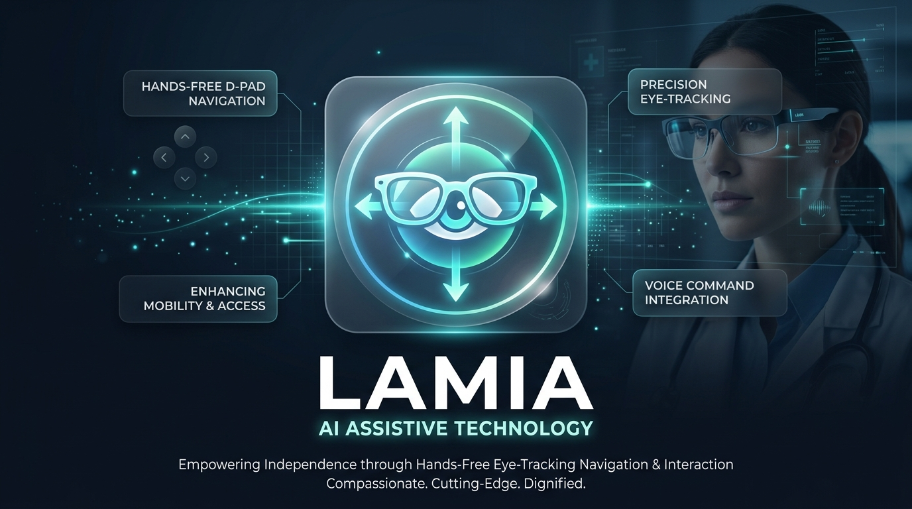
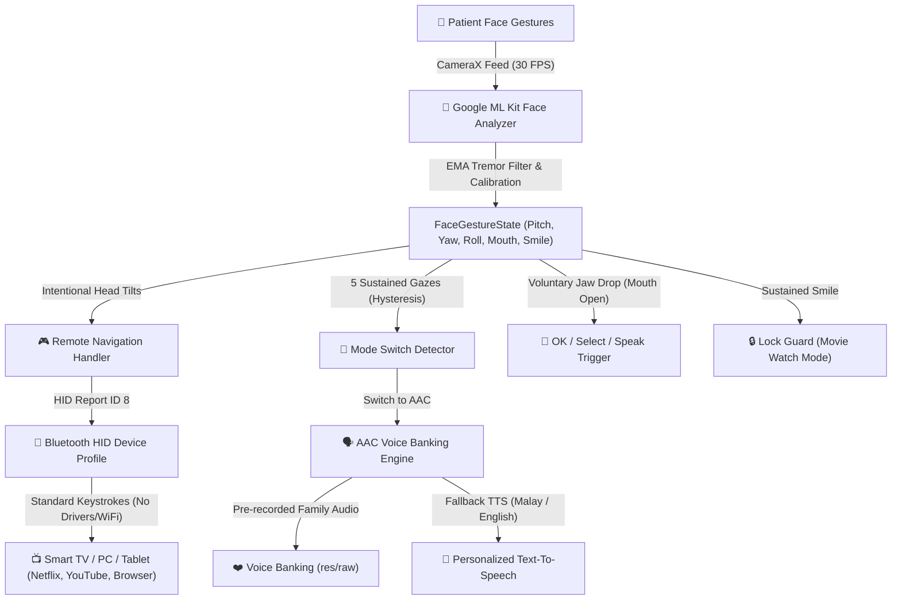

# LAMIA — AI-Powered Hands-Free Assistive Controller & AAC Platform 👓📱

[](https://opensource.org/licenses/Apache-2.0)
[](https://developer.android.com)
[](https://kotlinlang.org)
[](https://developers.google.com/ml-kit)
[](https://source.android.com)

<p align="center">
  
</p>

> **Restoring autonomy, dignity, and communication for individuals with severe motor disabilities — at zero hardware cost.**

---

## 🌟 The Human Problem

When an individual suffers from **stroke, Cerebral Palsy, ALS, locked-in syndrome, or high-level spinal cord injury**, their mind often remains fully alert, but their physical voice and motor faculties are trapped. 

Caregivers face the exhausting emotional burden of trying to guess basic human needs (eating, drinking, bathroom, comfort) while patients experience profound frustration and helplessness.

Existing medical eye-tracking rigs cost between **RM 15,000 and RM 30,000 (~$3,500 – $7,000 USD)**, requiring bulky mounting brackets, continuous recalibration, and specialized software.

---

## 🚀 What is LAMIA?

**LAMIA** bridges this divide by turning an everyday Android smartphone into a high-precision, on-device AI controller that translates **natural head tilts and voluntary facial gestures** into direct actions.



### 🛣️ Product Roadmap: From Smartphone to AI Smart Glasses
* **Phase 1 (Today's Working Prototype):** Zero-hardware-cost on-device Android application mounted on a bedside clamp.
* **Phase 2 (Commercial Vision):** Embedded on-board **AI Smart Glasses** (such as RayNeo or XREAL) with inward-facing eye/face micro-sensors, eliminating clamps and screens entirely.

---

## ✨ Key Features

### 1. 🎮 Direct Smart TV & PC Remote Navigation (Bluetooth HID)
- **Zero Software on Host:** Connects as a standard Bluetooth HID Keyboard/Mouse peripheral. Works instantly on Android TV, Apple TV, PC, Mac, Linux, and set-top boxes with **no drivers, no apps, and no Wi-Fi**.
- **Intuitive Head Tilts:** Nod UP/DOWN/LEFT/RIGHT to move through streaming catalogs (Unifi TV, YouTube, Netflix).
- **Mouth-Open Trigger:** Voluntary jaw drops trigger `ENTER / OK / PLAY` with configurable debounce cooldown.
- **Smart Back & Play/Pause Macro:** 
  - Tilting ear toward **right shoulder** (>9.5°) triggers `Smart Back` (`ESC` + `Alt+Left`).
  - Tilting ear toward **left shoulder** triggers `Play / Pause` (`Spacebar`).
- **Auto-Repeat Scrolling:** Holding a head tilt past 450ms initiates smooth catalog scrolling at 350ms intervals.

### 2. 🗣️ AAC Voice Banking D-PAD (High-Fidelity Emotional Speech)
Four fundamental quadrants mapped to immediate physiological and emotional needs:
- ⬆️ **UP (MAKAN / MINUM):** `"[Caregiver], saya nak makan, dahaga nak minum air."`
- ⬅️ **LEFT (TANDAS / SELESA):** `"[Caregiver], tolong bawa ke tandas, betulkan posisi saya."`
- ⬇️ **DOWN (KECEMASAN 🚨):** Dual-burst haptic feedback + loud emergency chime tone + alert voice: `"[Caregiver], tolong saya! Ada kecemasan!"`
- ➡️ **RIGHT (KASIH SAYANG ❤️):** `"[Caregiver], terima kasih selalu jaga saya. Minta maaf susahkan awak... I love you."`

> **Caregiver Personalization:** Caregiver name is dynamically customizable (default `"BABA"`, customizable to `"IBU"`, `"MAMA"`, `"SAYANG"`, `"NURSE"`).

### 3. 🧠 On-Device Vision Engine & Tremor Filtering
- **Exponential Moving Average (EMA):** Dynamic smoothing factor (0.35) cancels high-frequency involuntary spasms and muscle tremors common in quadriplegia and cerebral palsy.
- **Auto Resting Baseline Calibration:** Automatically calibrates the user's natural head orientation at startup, adapting to tilted pillows or contractures.
- **Smile Controller Lock:** Smiling held for ~120ms toggles a control lock, freezing all D-Pad triggers so patients can watch movies without accidental inputs.
- **5-Gaze Sequence Mode Switching:** Looking 5 times deliberately to the left activates AAC Voice mode; looking 5 times to the right returns to Remote mode — requiring return-to-center deadzone passage between glances to prevent accidental mode switches.

### 4. 🎓 Hands-Free Web Learning Hub (`lamia-quiz/`)
An accessible 4-quadrant educational web application included in the repository:
- High-contrast, dark-mode accessible UI with glowing visual indicators.
- Controlled completely hands-free via the LAMIA Bluetooth HID controller.
- Synthesized **0ms latency Web Audio** sound effects (arpeggios, buzzers) + Web Speech TTS.
- **Auto-Scan Mode:** Automatically cycles options every 2.5 seconds for users who can only perform a single voluntary movement (mouth drop).

---

## 🛠️ Technology Stack

| Layer | Technologies |
| :--- | :--- |
| **Operating System** | Android (minSdk 28 / Pie, targetSdk 34) |
| **Language** | Kotlin 1.9.22 (Coroutines, ViewBinding) |
| **Computer Vision** | Google ML Kit Face Detection & Contour API (30 FPS on-device) |
| **Camera Framework** | Android Jetpack CameraX (`ImageAnalysis`) |
| **Wireless Protocol** | Android `BluetoothHidDevice` Peripheral Profile |
| **Audio & Speech** | Android `MediaPlayer`, `ToneGenerator`, `TextToSpeech` |
| **Web Hub** | HTML5, CSS Custom Properties, Web Audio API, Web Speech API |

---

## 📦 Project Directory Structure

```
.
├── lamia/                                # Android Native Application
│   ├── app/src/main/
│   │   ├── java/com/lamia/assistive/
│   │   │   ├── MainActivity.kt           # Lifecycle coordinator
│   │   │   ├── config/
│   │   │   │   ├── GestureConfig.kt      # Configurable thresholds & cooldowns
│   │   │   │   └── UserSettings.kt       # Caregiver personalization & voice settings
│   │   │   ├── gestures/
│   │   │   │   ├── ModeSwitchDetector.kt # 5-gaze sequence detector with deadzones
│   │   │   │   ├── RemoteNavigationHandler.kt # D-Pad auto-repeat & roll gestures
│   │   │   │   └── LockGestureDetector.kt# Smile controller lock detector
│   │   │   ├── bluetooth/
│   │   │   │   ├── BluetoothController.kt# Bluetooth HID service & bonding manager
│   │   │   │   ├── KeyboardSender.kt     # Atomic HID report dispatcher
│   │   │   │   └── reports/              # USB HID byte report structures
│   │   │   ├── speech/
│   │   │   │   └── AacSpeechManager.kt   # Voice Banking & personalized TTS
│   │   │   ├── ui/
│   │   │   │   └── UiStateManager.kt     # UI button styling & guidance updates
│   │   │   └── vision/
│   │   │       ├── FaceGestureAnalyzer.kt# ML Kit detector & tremor smoothing
│   │   │       └── HeadPoseDirection.kt  # Directional data model
│   │   └── res/
│   │       ├── layout/activity_main.xml  # Accessible dual-mode layout
│   │       ├── values/strings.xml        # Default strings
│   │       ├── values-ms/strings.xml     # Bahasa Melayu localization
│   │       └── values-en/strings.xml     # English localization
│   └── build.gradle.kts
├── lamia-quiz/                           # Hands-Free Educational Web App
│   ├── index.html                        # 4-quadrant responsive interface
│   ├── app.js                            # Web Audio & switch navigation controller
│   ├── questions.js                      # Educational question database
│   └── style.css                         # High-contrast accessibility theme
├── .github/workflows/android.yml         # Continuous Integration & Build Pipeline
├── CONTRIBUTING.md                       # Open source contribution guidelines
├── LICENSE                               # Apache 2.0 Open Source License
└── README.md
```

---

## 🏃 Getting Started

### 1. Build and Run the Android App
```bash
cd lamia
./gradlew assembleDebug
```
The compiled APK will be at:
`app/build/outputs/apk/debug/app-debug.apk`

### 2. Pair with TV / PC
1. Launch **LAMIA** on your Android phone and grant Camera and Bluetooth permissions.
2. Tap the **Bluetooth Status Pill** (top of remote section).
3. Select **"Make Phone Discoverable"**.
4. On your Smart TV, PC, Mac, or streaming box, open Bluetooth settings and pair with **"LAMIA Controller"**.
5. Once connected, mount the phone on a bedside clamp facing the patient.
6. Press **"Calibrate Rest"** while the patient is looking comfortably at the center of the screen.

### 3. Run the Hands-Free Learning Hub
Simply open `lamia-quiz/index.html` in Google Chrome, Microsoft Edge, or Android TV browser. Use the LAMIA controller to answer questions hands-free!

---

## 🤝 Contributing

We welcome contributions from engineers, caregivers, speech-language pathologists, and accessibility advocates worldwide!
Please read our [CONTRIBUTING.md](CONTRIBUTING.md) guide before submitting pull requests.

---

## 📄 License

This project is licensed under the **Apache License 2.0** — see the [LICENSE](LICENSE) file for details.

---

## 👥 Authors & Team VisionKing
* **Mustaqeem** — Core Architecture & Vision Pipeline
* **Ikhwan** — Bluetooth HID & System Integration
